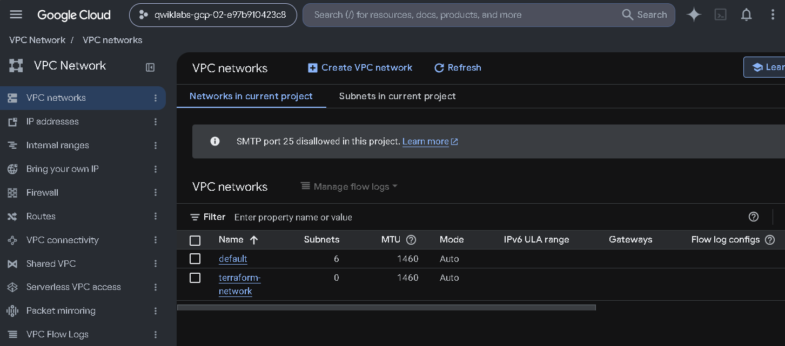
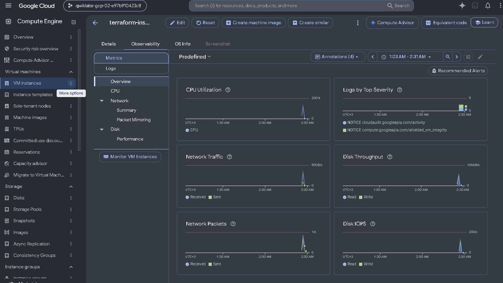

# GCP Infrastructure as Code with Terraform

Reproducible Google Cloud networking + compute, built incrementally with Terraform: VPC, VM instance, reserved static IP, resource dependencies and a `local-exec` provisioner.

> **Transparency note:** This is a hands-on, scenario-based portfolio project, executed in a Google Cloud Skills Boost sandbox (lab **GSP750**, "Infrastructure as Code with Terraform"). The "engagement" below is a realistic scenario I used to structure the work. It is not a paid client project. Commit history was reconstructed from my recorded session so the progression is easy to follow. All logs and screenshots are from the real run.

## Scenario

A small product team needed a **repeatable dev environment on GCP**: an isolated network, a VM with a fixed public IP, and an audit trail of what was created. Click-ops in the console was error-prone and undocumented, so the requirement was to manage everything as code.

**Acceptance criteria**
- [x] Dedicated VPC (no reliance on `default`)
- [x] VM (`e2-micro`, Container-Optimized OS) tagged `web`, `dev`
- [x] Reserved **static external IP** attached to the VM
- [x] Changes reviewed with `terraform plan` before every apply
- [x] Instance IP recorded automatically on provisioning
- [x] Clean teardown possible with `terraform destroy`

## Stack

| Area | Choice |
|---|---|
| IaC | Terraform, `hashicorp/google` provider `3.5.0` |
| Cloud | Google Cloud (Compute Engine, VPC, external addresses) |
| Region / zone | `us-central1` / `us-central1-b` |
| Environment | Cloud Shell (ephemeral), Skills Boost sandbox project |

## Architecture

```
terraform-network (VPC, auto mode)
        |
        +-- terraform-instance (e2-micro, cos-stable, tags: web, dev)
                 |
                 +-- terraform-static-ip (reserved external IPv4)
```

Dependencies are **implicit**: the instance references the network's `self_link` and the address's `.address`, so Terraform orders creation correctly (network and IP first, instance last).

## Delivery timeline (see `git log`)

| Phase | What changed | Concept demonstrated |
|---|---|---|
| 1. Foundation | Provider config + `google_compute_network` | `init`, state, provider pinning |
| 2. Compute | Added `google_compute_instance` | `plan` / `apply` / `show` |
| 3. Change management | Added tags (in-place update), changed boot image (forced **replacement**) | Mutable vs immutable changes, destroy/recreate |
| 4. Networking | Reserved static IP, attached to instance | Implicit dependencies |
| 5. Dependencies | Experiment with explicit `depends_on` (second VM + bucket) | Explicit dependencies, then cleanup of drift via apply |
| 6. Provisioning | `local-exec` writes `name: IP` to `ip_address.txt` | Provisioners, `terraform taint` to force re-run |

Final configuration: [`main.tf`](main.tf). Each phase is its own commit, so `git diff` between commits shows exactly what changed.

## Evidence

**VPC created by Terraform** (`terraform-network` alongside `default`):



**Provisioned VM, Compute Engine observability view:**



**Provisioner output** ([`evidence/ip_address.txt`](evidence/ip_address.txt)):

```
terraform-instance: 34.135.213.141
```

**Session log:** [`logs/terraform-session.log`](logs/terraform-session.log) (command history, `terraform show`, plans and applies). Highlights:

- `Plan: 1 to add, 0 to change, 3 to destroy` — config drift reconciled: resources not in code get removed
- `Plan: 0 to add, 1 to change, 0 to destroy` — in-place update (tags)
- `Plan: 1 to add, 0 to change, 1 to destroy` — forced replacement (boot image change)
- `terraform plan -out static_ip` then `terraform apply "static_ip"` — applying a **saved plan** so what was reviewed is exactly what runs
- `terraform taint` followed by apply — forced recreation, triggering the `local-exec` provisioner
- A transient **HTTP 401 (invalid credentials)** appeared during state refresh in the log. It was a session/auth issue with the ephemeral sandbox credentials, not a config error; left in the log unedited.

## How to run

```bash
gcloud auth login
gcloud config set project <YOUR_PROJECT_ID>   # edit project in main.tf too
terraform init
terraform plan -out tfplan
terraform apply tfplan
terraform destroy      # when done
```

## What I'd do differently in production

Being honest about the gaps in a sandbox-grade config:

- **Remote state** (GCS bucket with versioning + locking) instead of local `terraform.tfstate`. State files are git-ignored here because they can contain sensitive values.
- **Variables/tfvars** for project, region and names instead of hardcoded values; split into `variables.tf`, `outputs.tf`.
- **Upgrade the provider** (pinned to `3.5.0`, which is old) and use `google_compute_firewall` rules to restrict ingress; the VPC here has none beyond defaults.
- **Custom-mode VPC with explicit subnets** rather than auto mode.
- **Service account + least privilege** for the VM, **modules** for reuse, and a **CI pipeline** (`fmt`, `validate`, `plan` on PR; `apply` on merge).
- Replace `local-exec` with a proper `output` — provisioners are a last resort.

## Repo layout

```
main.tf                final configuration
logs/                  terraform session log
evidence/              provisioner output
docs/img/              console screenshots
.gitignore             excludes state, plans, .terraform
```
